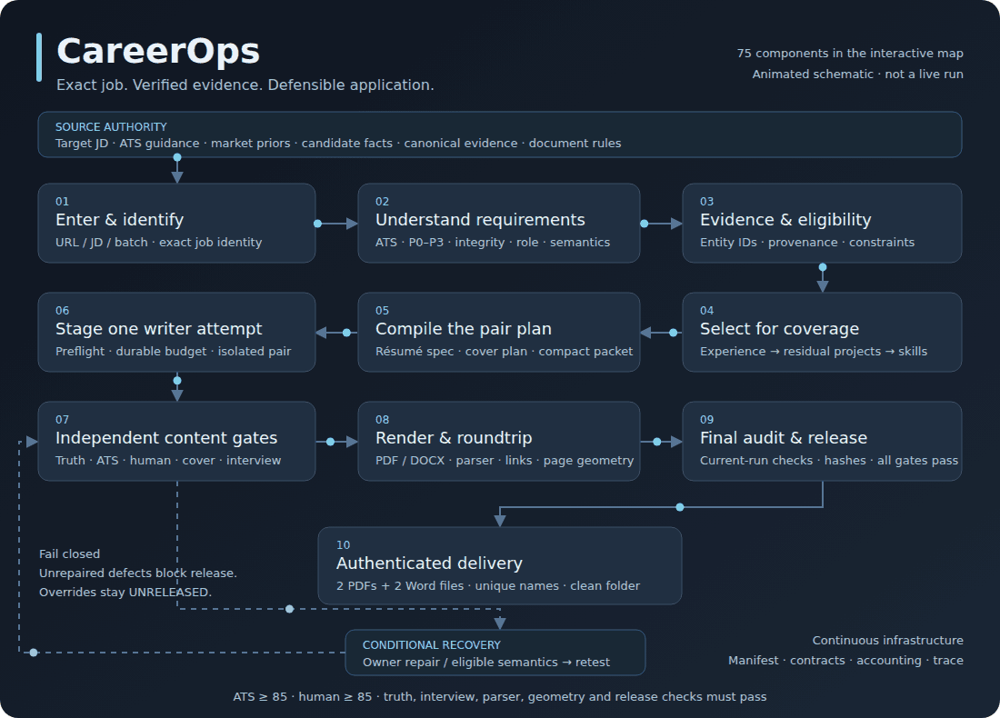

# CareerOps

**A job-first résumé and cover-letter engine built for machine readability, human judgment, and claims you can defend in an interview.**

CareerOps turns an exact job description, explicit candidate authority, and verified evidence into a tailored application pair. It separates analysis, selection, writing, validation, rendering, and release. Every job has its own source identity, run state, provenance, and output ownership.

## Why I built it

After months of applying for jobs, I kept returning to the same problem: a qualified applicant can struggle to get their experience in front of the right person. Tools such as AIApply, Jobscan, and other application platforms made ATS compatibility a visible part of that process, but a score alone did not answer the question I cared about: **does this application clearly show why this person can do this specific job?**

There are two audiences to reach. First, the application has to remain readable and searchable through the employer’s application system. Then a recruiter has to see relevant experience, technical substance, and credible accomplishments quickly. A document optimized around repeated keywords can still be difficult to read, generic, or impossible to defend. Hidden text, tiny characters, and other formatting tricks add fragility instead of making the candidate’s experience clearer.

I also needed volume: **at least 50 individually tailored résumé-and-cover pairs**. That was the design requirement. I wanted each pair to reflect the actual job, preserve technical depth, and remain grounded in real evidence. Unsupported accomplishments, invented tool placements, repetitive phrasing, and generic paragraphs would defeat the purpose.

That combination shaped the engine: make truthful fit visible to both the parser and the person, then verify the actual documents before delivery.

## The approach

I extended the existing [Career-Ops](https://github.com/career-ops-hq/career-ops) foundation into a structured tailoring pipeline. The important decisions happen before writing begins.

1. **Start with the exact job.** Preserve the JD, employer, position, requisition, and application identity. Separate mandatory requirements from core, supporting, and preferred requirements.
2. **Understand the parsing environment.** Identify the ATS when possible and apply relevant formatting and retrieval guidance. Record uncertainty where the employer’s configuration is unknown.
3. **Build an evidence model.** Keep employment, projects, tools, dates, metrics, ownership, and claim boundaries connected through canonical entities and provenance.
4. **Select evidence deliberately.** Choose professional experience first, calculate the remaining coverage gaps, and select projects that add useful proof. One underlying project stays one project.
5. **Preserve technical depth.** Curate coherent skills categories from supported inventory. Prioritize JD relevance while retaining useful adjacent methods and technologies. Deduplicate concepts and aliases, and keep category labels distinct from their children.
6. **Compile a writing contract.** Build the résumé specification, cover plan, compact context, shared identity, selected evidence IDs, and physical layout budget into one pair packet.
7. **Use a bounded writer.** Generate staged candidates through an isolated model transport. Durable invocation receipts prevent a resumed run from casually replaying a completed call.
8. **Let independent validators decide.** Check truth, ATS compatibility, human quality, cover quality, interview defensibility, rendered geometry, parser roundtrips, and final requirement visibility.
9. **Repair at the owning stage.** Diagnose a source, constraint, semantic, writing, or rendering failure before choosing a repair. Retest the original gate. Unresolved defects stay blocked.
10. **Deliver authenticated artifacts.** Release only the passing current-run pair, and copy its four documents into a clean collection with unique filenames and matching hashes.

The writer can propose wording. It cannot create candidate facts, waive eligibility, change provenance, or approve its own output.

## Architecture in motion

[](https://jntnayeemmsbdsa.github.io/CareerOps/)

**[Open the full interactive architecture](https://jntnayeemmsbdsa.github.io/CareerOps/)** — 75 selectable stages and support components, moving flows, validation boundaries, recovery paths, and quarantined overrides.

The image above plays directly in the README. The interactive link becomes available after GitHub Pages is enabled for this repository; it has not been deployed as part of local preparation. You can already open [docs/index.html](docs/index.html) in a browser after cloning. [Hosting instructions](docs/HOSTING.md) explain the Pages setting and the link to change in a fork. GitHub Markdown does not execute embedded scripts or iframes. [GitHub’s Markdown specification](https://github.github.com/gfm/#disallowed-raw-html-extension-).

### The complete production path

| Phase | What happens |
|---|---|
| Enter and identify | Single job, URL list, mixed batch, pasted/clipboard text, URL probing, manual fallback, source/requisition reconciliation, isolated run creation. |
| Understand requirements | ATS detection and profiles; source-grounded P0–P3 ledger; integrity checks; role routing; exact phrases, semantic equivalents, qualifiers, and effective views. |
| Resolve evidence and eligibility | Canonical entity resolution; requirement-to-evidence mapping; historical tool placement; duration, education, domain, authorization, and qualified AND/OR constraints. |
| Select for coverage | Employment first; residual gaps; complementary projects; technical depth; coherent skills categories; concept and alias deduplication. |
| Plan the pair | Summary mode; résumé specification; writing and page budgets; cover authority and proof plan; compact context; shared generation packet. |
| Write candidates | Pre-writer constraint gate; model availability and budget preflight; durable transport receipt; isolated pair generation; schema and job-contract validation. |
| Validate content | Atomic local truth; canonical truth and claim map; ATS gate; human-quality gate; cover gate; interview defensibility. |
| Render and compare | Canonical payload; locked HTML; adaptive layout; résumé PDF/DOCX; résumé roundtrip; cover PDF/DOCX; cover roundtrip; physical parity and rendered page audits. |
| Audit and release | Final JD visibility and drift audit; fresh current-run gate reports; score thresholds; contact identity; document packages, hashes, paths, parser and geometry checks. |
| Deliver and account | Canonical artifacts; authenticated delivery; independent Daily Output copies; explicit file/folder opening; outcome, decision receipts, and resumable checkpoints. |

### Recovery and continuous services

- **Semantic ambiguity:** eligible disagreement → local Qwen probe and grounding checks → shared Sol adjudication when permitted and still unresolved → deterministic reconstruction → rerun the original gate. Suggestions cannot mutate immutable source authority or release an application.
- **Deterministic recovery:** classify the defect, repair the owning component where permitted, refresh dependent state, and retest. Mechanical failures do not justify an automatic extra writer call.
- **Explicit overrides:** user-authorized work runs in a separate quarantine context. Any delivered override documents retain an **UNRELEASED** disposition and filename marker. They cannot impersonate a normal release.
- **Continuous infrastructure:** stage orchestration, manifests, typed intelligence contracts, invocation accounting, observed capability traces, explicit configuration, optional advisory/shadow diagnostics, and synthetic isolation tests support the entire pipeline.

## What a successful run produces

Each eligible completed job delivers:

- Résumé PDF.
- Résumé DOCX.
- Cover-letter PDF.
- Cover-letter DOCX.

`Daily Output/` accumulates these documents across jobs and batches with unique filenames. Copies are independent of the canonical run files. Audit reports, claim maps, manifests, decision receipts, staging, and logs remain in the run/audit directories rather than cluttering the delivery folder.

Delivery verifies exact artifact bytes and ownership. Copying or opening a document does not grant release authority or submit an application.

## Try the public example

### Requirements

- Linux, including Ubuntu in WSL. Native Windows Python is currently unsupported because the delivery and accounting code uses POSIX locking.
- Python 3.11 or newer, with virtual-environment support.
- Node.js 22 or newer and npm.

The public example and deterministic checks do not require an API key, authenticated writer, or live local model. Run the commands below from the **repository root in an Ubuntu/Linux terminal**. GitHub Desktop can still manage the Windows checkout.

```bash
cd /path/to/CareerOps

python3 -m venv .venv
source .venv/bin/activate
python -m pip install -r requirements.txt
npm ci --ignore-scripts

export CAREEROPS_SOURCE_DIR=examples/source
export CAREEROPS_SEMANTIC_CHALLENGER=0
export CAREEROPS_SHARED_SOL_SEMANTIC=0
export CAREEROPS_LI_ADVISORY=0
export CAREEROPS_INTERVIEW_DEFENSIBILITY=1

python scripts/careerops_career_ops.py self-test

python scripts/careerops_career_ops.py single \
  --jd-file examples/jobs/data-analyst.txt \
  --company "Glasswing Civic Archive" \
  --position "Data Analyst" \
  --stop-after pair_packet \
  --no-prompt
```

This stops **before writing**, so it does not generate application documents or make model calls. It demonstrates intake, requirements, routing, evidence, constraints, selection, skills, and pair planning using an entirely fictional candidate and employer.

All example identities, jobs, dates, metrics, and evidence are synthetic. Reserved `.invalid` links are inert. The two-role sample demonstrates the inventory schema; it is not a market research dataset. [Example run outputs](examples/run) illustrate the packet-stage artifacts and do not represent an approved production application.

## Configure your own candidate

Create an ignored private authority directory, copy the example schemas, and replace their fictional contents with your own verified information:

```bash
mkdir -p candidate/source
cp -R examples/source/. candidate/source/
export CAREEROPS_SOURCE_DIR=candidate/source
```

| Authority file | What to configure |
|---|---|
| `candidate_facts.json` | Identity, education, chronology, experience blocks, skill duration, certifications, authorization, and entity-specific claim boundaries. |
| `candidate_attestations.json` | Explicit factual confirmations and their scope; keep capability possession distinct from historical usage. |
| `verified_evidence_inventory.md` / `verified_evidence_index.csv` | Canonical employment/project evidence, evidence IDs, methods, outputs, quantities, and limits. |
| `tool_evidence_matrix.csv` | Which tools and methods belong to which supported entities. |
| `assumed_market_coverage.json` | Clearly classified capability coverage; it cannot invent historical work or metrics. |
| `application_role_universe_top50.json` / `market_research_50_roles.md` | Your targeting inventory and contextual priors. Declared role counts must match the configured inventory. |
| `cover_letter_rules.json` / `resume_layout_budget.json` | Cover structure, writing constraints, and physical document budgets. |

Keep IDs, dates, ownership, tools, evidence and claim boundaries consistent across these files. Missing authority fails closed. Remove every fictional claim before attempting a real application. Keep this material local and out of commits.

[.env.example](.env.example) documents the relevant environment variables. It is a template: the engine does **not** silently load it. The default source directory is `candidate/source`; there is no hidden fallback to another private checkout.

### Enable full writing and rendering

Full generation uses a separately installed, authenticated inference CLI. The retained adapter invokes `codex exec`; its configured model is `gpt-6.1-sol` with XHigh reasoning for pair writing and High for shared semantic adjudication. Model preflight must confirm that the installed, authenticated runtime supports the requested target. An API-key placeholder alone does not configure this transport.

Install the rendering backends for your Linux distribution. For Ubuntu:

```bash
sudo apt update
sudo apt install libreoffice-writer poppler-utils
npx playwright install --with-deps chromium
```

Optional local intelligence uses a configured Ollama endpoint and Qwen model. Enable semantic/advisory flags deliberately after configuring those backends. Normal public examples keep them disabled. No model weights, credentials, signature images, or font binaries are distributed; system fonts can affect fit and must pass fresh layout checks.

See [local setup](docs/SETUP.md) and [runtime contracts](docs/RUNTIME.md) for the exact boundaries.

## Everyday commands

Run these from the repository root with the virtual environment active and your private source directory selected. Full runs may consume authenticated model usage; append `--stop-after pair_packet` when you only want analysis and planning.

### One saved job description

```bash
python scripts/careerops_career_ops.py single \
  --jd-file candidate/jds/analyst.txt \
  --company "Example Employer" \
  --position "Data Analyst"
```

### One job URL

```bash
python scripts/careerops_career_ops.py single --url "YOUR_JOB_URL"
```

The CLI attempts source and identity resolution and can request a manual JD when retrieval is insufficient. `--no-prompt` queues/reports the missing input instead of asking interactively. URL accessibility and ATS configuration vary.

### A list of job URLs

```bash
python scripts/careerops_career_ops.py urls \
  --file candidate/job-urls.txt \
  --continue-on-error \
  --no-prompt
```

Use one real URL per line. Continuing a batch does not waive a failed job’s gates.

### A mixed batch

Create an ignored `candidate/jobs.json` using the [batch example](examples/jobs/batch.json). Entries can contain a JD file, JD text, or an application URL. JD-file/text entries require explicit employer and position identity. Use unique `run_id` values, or resume an existing run rather than overwriting it.

```bash
python scripts/careerops_career_ops.py batch candidate/jobs.json \
  --continue-on-error \
  --no-prompt
```

### Resume or open an existing run

```bash
python scripts/careerops_career_ops.py resume RUN_ID
python scripts/careerops_career_ops.py open RUN_ID folder
python scripts/careerops_career_ops.py open RUN_ID resume_pdf
```

Use the run ID printed by the CLI. Resume preserves completed stage/model receipts. Opening an existing artifact performs delivery checks and does not regenerate it.

For the complete interface:

```bash
python scripts/careerops_career_ops.py --help
python scripts/careerops_career_ops.py single --help
python scripts/careerops_career_ops.py batch --help
```

## Acceptance, cost and limits

| Boundary | Release requirement |
|---|---|
| Requirements and eligibility | Source-grounded requirements; unresolved mandatory conflicts block normal writing/release. |
| Truth and provenance | Supported claims, metrics, entities, chronology and historical tool placement. |
| ATS and human quality | Internal scores of at least **85**, plus the applicable mandatory quality checks. |
| Cover and interview | Grounded cover content and defensible interview-facing claims. |
| Documents | Valid PDF/DOCX packages, parser/content roundtrips, correct contact targets, one-page constraints and physical layout checks. |
| Final release | Fresh current-run reports, approved ownership, matching hashes and all mandatory gates passing. |

These are **internal acceptance checks**, not an employer’s proprietary ATS score, a Jobscan score, or a hiring guarantee. Detection of an ATS platform does not reveal the employer’s enabled ranking rules. Human-quality checks are useful engineering criteria; recruiter judgment remains individual.

Normal pair writing is budgeted as one isolated call. Semantic adjudication is separate and bounded. Durable receipts record attempts and completion; an explicit failed-transport retry contract can permit a bounded additional attempt. Arbitrary repeated writing is not the default recovery strategy.

The public snapshot passed 37 Python tests, 2 Node tests, syntax/dependency checks and an isolated fictional pipeline/rendering smoke test. See [verification evidence](docs/verification.json). Live inference, live ATS retrieval and browser PDF generation were not exercised by that public verification. The rendered synthetic Word audit and HTML/payload checks did pass. The 50-pair requirement is a design target, not a published throughput benchmark.

## Tests

```bash
python -m unittest discover -s tests -p 'test_*.py' -v
npm test
python scripts/careerops_production_orchestrator.py --self-test
```

For the stronger Linux isolation harness, install your distribution’s trusted `bubblewrap` package and the rendering backends, then run:

```bash
python tests/run_isolated.py --node "$(command -v node)"
```

The harness mounts the public checkout and required system runtimes, leaves private home directories unavailable, disables networking, and uses fictional fixtures/mocked model transports. Logs and generated documents stay ignored.

## Repository guide

```text
scripts/       CLI, orchestration, planning, model interfaces, gates and delivery
lib/           Shared payload, module and page-format helpers
config/        ATS platform and behavior profiles
templates/     Résumé and cover render templates
examples/      Fictional candidate, job, evidence, local-intelligence and run schemas
tests/         Deterministic regressions, renderer checks and isolation harness
docs/          Setup, contracts, interactive architecture and publication evidence
```

Start with [SETUP](docs/SETUP.md), then [RUNTIME](docs/RUNTIME.md). The [source manifest](docs/source-manifest.json) records the public allowlist; the [publication scan](docs/public-scan.json) records the sanitization boundaries.

Useful contributions include source-grounded requirement handling, ATS compatibility profiles, constraint semantics, skills curation, provenance checks, renderer fidelity, and synthetic regression cases. Include a reproducible fictional fixture and keep truth, eligibility, and release gates intact. Never attach candidate records, real application artifacts, credentials, private corpora, or proprietary fonts to a contribution.

## License and origin

CareerOps derives from and extends [Career-Ops](https://github.com/career-ops-hq/career-ops). The upstream copyright and permission notice remain in [LICENSE](LICENSE); additional provenance is in [NOTICE](docs/NOTICE.md). The project is distributed under the MIT license. No upstream or third-party platform endorsement is implied.
